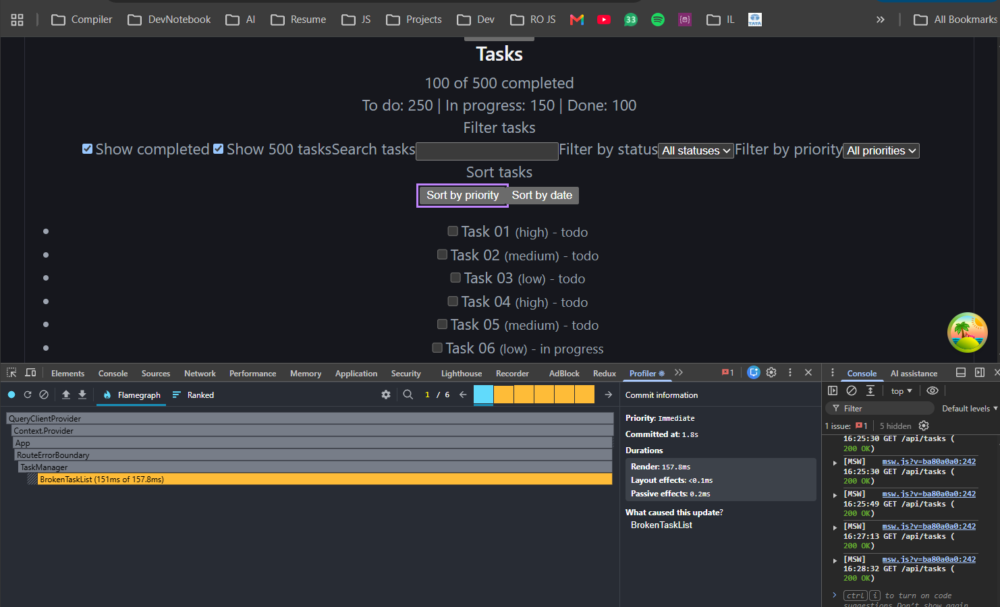

## 1. Baseline measurement

Loaded the 500-task sample dataset by checking **Show 500 tasks**, then recorded with the React DevTools Profiler. Clicking **Sort by priority** or **Sort by date** took 157.8 ms to render. About 151 ms was spent inside `BrokenTaskList`. The Profiler showed that `BrokenTaskList` caused the update, not a parent component.

## 2. Root cause

`BrokenTaskList.tsx` did not use `useMemo`, `useCallback`, or `React.memo`. On every render, it processed all the 500 tasks:

- It filtered the sample tasks by search text, status, and priority.
- It called `getVisibleTasks()`, which filters the tasks and may sort them.
- It made three more passes through the tasks to count completed tasks and tasks by status.

The task rows were also created directly inside `.map()`. Because they were not separate components, React had to reconcile all 500 rows whenever `BrokenTaskList` rendered. This happened when sorting, showing or hiding completed tasks, typing in search, or changing a filter.

The task IDs were already stable, so the list keys were not the problem. No virtualization library was installed, but the main cost came from recalculating and reconciling tasks, not from the number of DOM elements. I also found no context provider or artificial slowdown code in `src`.

## 3. Fixes applied

- Added `useMemo` for `allTasks`, `tasks`, and `visibleTasks` so filtering and sorting only run again when their inputs change.
- Replaced the three separate task-counting passes with one `reduce` inside `useMemo`.
- Moved each row into a separate `TaskItem.tsx` component and wrapped it in `React.memo`.
