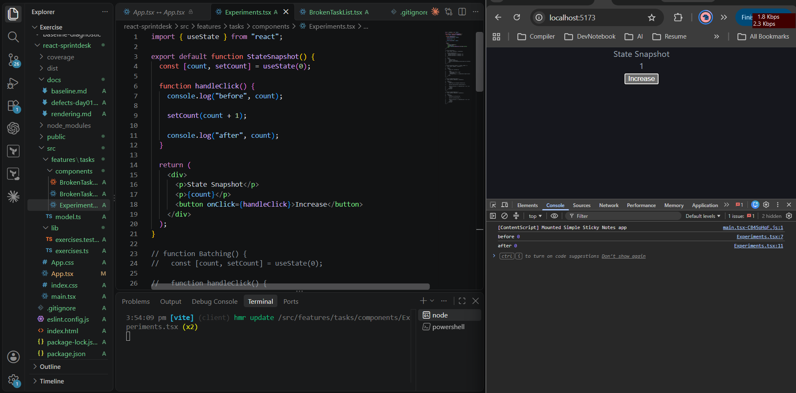
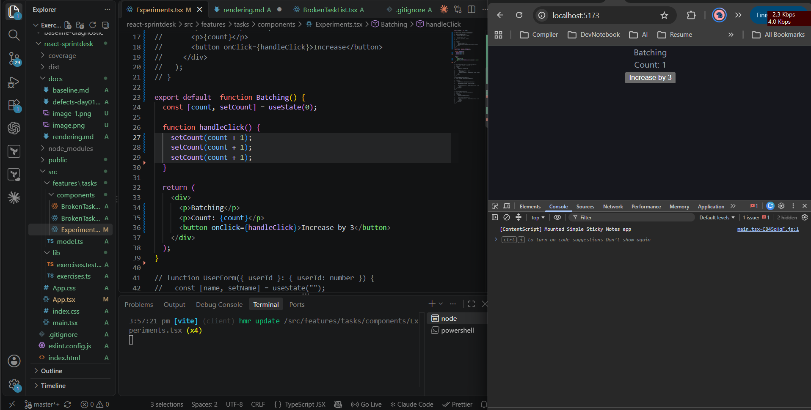
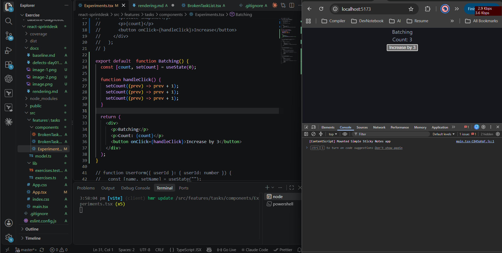
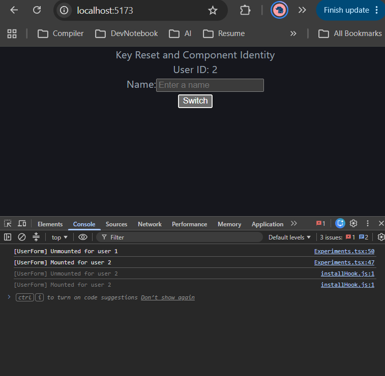
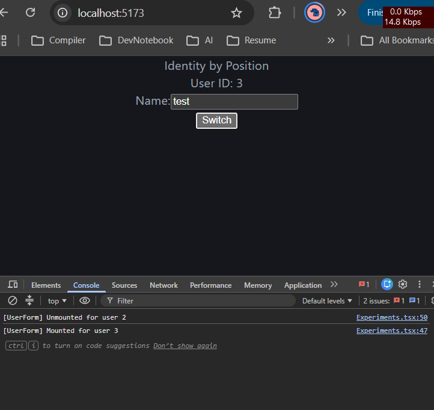
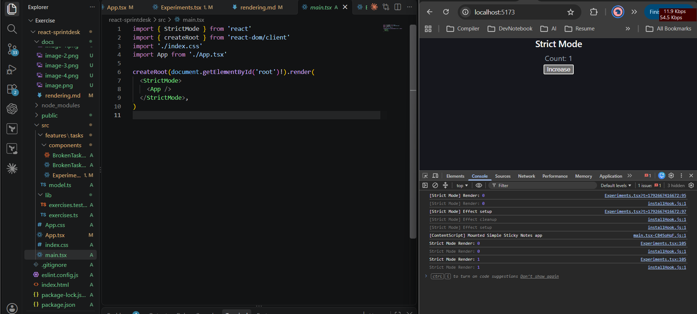

**React Rendering Experiments**

**1. State Snapshot**

Clicked the Increase button and checked the console. Both logs showed the previous count since state will not change immediately. React uses the state value from the render that created that handler. The updated value appears only after re-rendering.

**2. Batching**

- Without functional updates, calling setCount(count + 1) three times increased the count by only one because all three calls used the same state value.
-  With functional updates, the count increased by three with a single click because each update used the result of the previous update.
- React's default behavior batches the updates together and avoiding unnecessary renders.

**3. Key Reset**

Typed a name into the input and switched to another user. The input became empty. Changing a component's key tells react to treat it as a new component. Its local state is reset, which is useful when switching between forms for different records.

**4. Component Identity**

Removed the key and switched users again. The typed name stayed in the input because the component was still the same type in the same position. React preserves state based on a component's identity in the render tree, not just the props passed to it.

**5. Strict Mode**

While running the app in development with strict mode enabled some rendering logic ran more than once. The strict mode help to catch problems during development. The extra renders are intentional and production will not render twice

